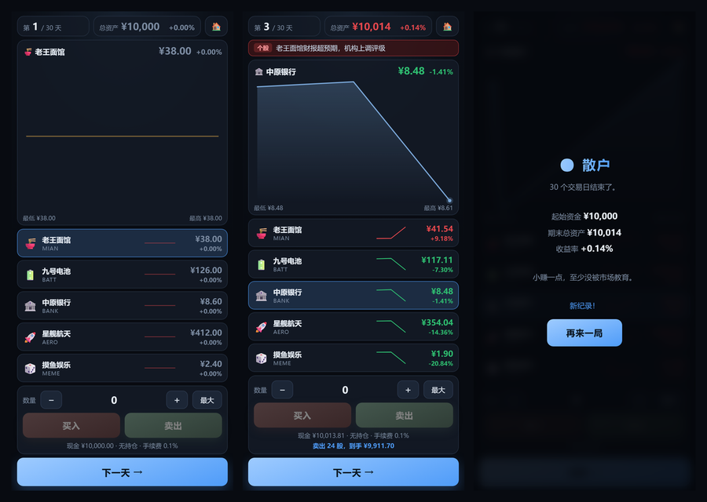

# 📈 股海浮沉

一个**手机优先**的 30 天炒股模拟小游戏。给你 ¥10,000 本金，30 个交易日，买哪只、什么时候走，全看你自己。

纯原生 HTML / CSS / JavaScript，**零依赖、零构建**，把仓库挂在 GitHub Pages 上就能当服务器玩。



**在线试玩：<https://qiuye-autumnnight.github.io/stock-sim/>**

> 手机上打开链接即可开玩；在浏览器菜单里选「添加到主屏幕」会全屏启动，断网也能玩。
> 想玩别的？回到 [🎮 游戏盒](https://qiuye-autumnnight.github.io/)。

## 玩法

- 起始资金 **¥10,000**，一共 **30 个交易日**
- 点列表切换股票，点「＋/－」调数量，「最大」一键满仓或清仓
- 点「下一天」推进，股价随机游走，偶尔会有突发新闻
- 30 天结束时按总资产给你一个称号

**红涨绿跌**，手续费 **0.1%**（买卖都收）。

## 五只股票

| 股票 | 代码 | 性格 |
| --- | --- | --- |
| 🍜 老王面馆 | MIAN | 慢牛，波动很小，适合练手 |
| 🏦 中原银行 | BANK | 稳如老狗，一天涨跌不到 1% |
| 🔋 九号电池 | BATT | 温和成长，中等波动 |
| 🚀 星舰航天 | AERO | 单日能涨跌 7%，一天一个心情 |
| 🎲 摸鱼娱乐 | MEME | 波动 10%，纯粹的赌桌 |

每开一局，每只股票的**长期趋势都会重新随机**一点点——所以上一局的经验不能直接套用。

## 突发新闻

每天有约 36% 的概率出新闻：

- **个股新闻**：财报超预期、拿下大额订单、被曝财务问题……
- **大盘新闻**：降息、经济数据超预期、外部利空——影响所有股票
- 航天和娱乐这类高波动股，新闻幅度也更大（涨停 / 被做空）

新闻会在推进当天直接叠加到价格上，然后再继续随机游走。

## 结算称号

按期末总资产相对本金（¥10,000）的倍数评级：

| 倍数 | 称号 |
| --- | --- |
| ≥ 10× | 👑 股神 |
| ≥ 3× | 🏆 高手 |
| ≥ 1.5× | 📈 老手 |
| ≥ 1× | 🙂 散户 |
| ≥ 0.7× | 😵 被套 |
| < 0.7× | 🥬 韭菜 |

历史最高总资产存在本机。

## 特性

- 📊 **走势图**：每只股票一条迷你走势，选中的股票有大图（面积填充 + 末端光点）
- 📰 **新闻条**：当天的事件按利好/利空染色
- ⚡ **买卖自动夹上限**：点「最大」后直接买/卖，不用为了凑整反复加减
- 💾 **最高纪录**：`localStorage` 保存，刷新不丢
- 📴 **离线可用**：Service Worker 缓存全部资源

## 本地运行

用到了 Service Worker，请用 HTTP 方式打开，不要直接双击 `index.html`：

```bash
python -m http.server 8000
```

然后访问 <http://localhost:8000>。

## 文件结构

```
.
├── index.html              # 页面结构
├── styles.css              # 样式与响应式布局
├── game.js                 # 行情随机游走、新闻、交易、Canvas 绘图
├── sw.js                   # Service Worker（离线缓存）
├── manifest.webmanifest    # PWA 清单
├── icons/                  # 各尺寸图标
├── screenshot.png          # README 预览图
└── .nojekyll               # 跳过 Jekyll
```

## 实现要点

- **`gauss()` 用三个均匀分布求和**：把 `Math.random` 固定成 0.5 时结果恰好是 0，于是价格只按 drift 走，每一次买卖的现金和持仓都能算到分——测试因此可以对数值做精确断言
- **买卖都自动夹到上限**：否则「最大」按钮对买入和卖出是两个不同目标，而小屏放不下两个按钮
- **交易回执单独占一行**：一开始回执和「现金 / 持仓」共用一行，买完就被覆盖了，玩家看不到余额
- **单点也画一条横线**：第 1 天只有一个数据点，不特殊处理走势图会是全空的

## License

[MIT](./LICENSE)
